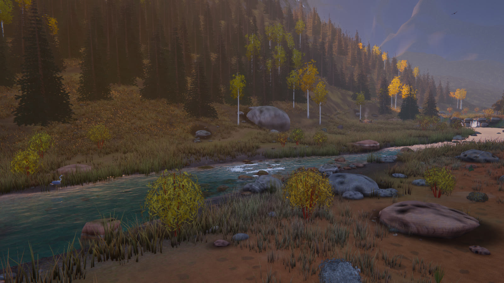
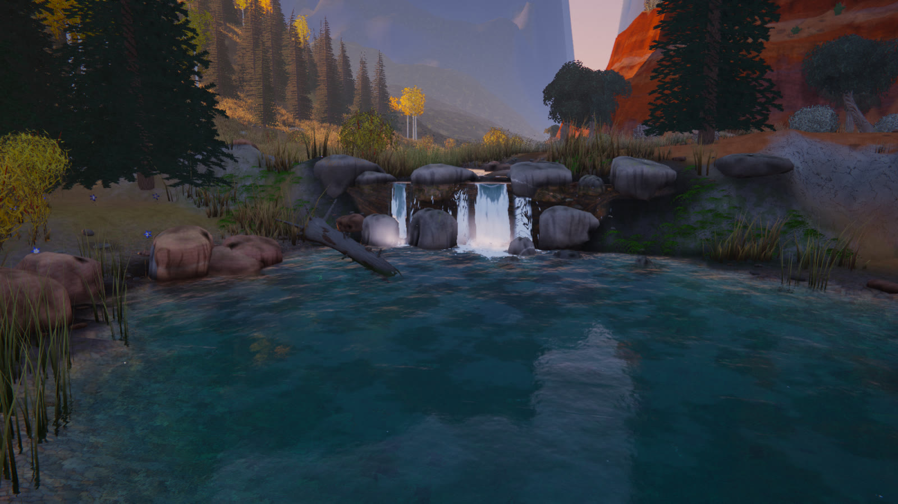
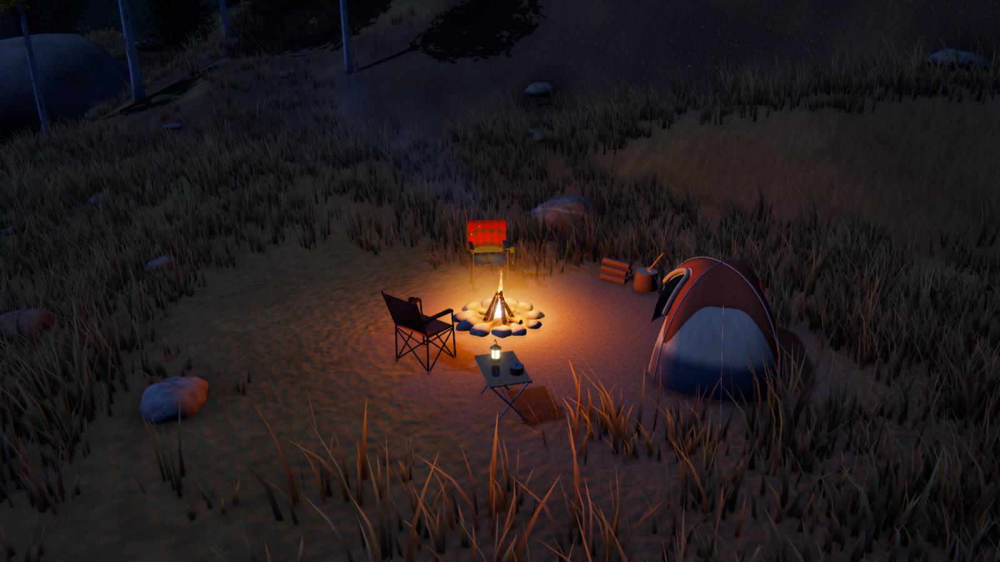
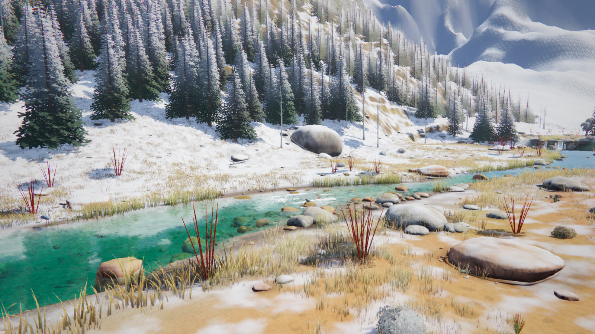

# Riffle

**A small, hand-built world where Colorado aspen country meets Utah sandstone, with a creek running through it.**
Wander, listen, and poke at things. There's no goal and no score: turn over stones, skip rocks, pitch a camp by the water and watch the light change.



<table>
  <tr>
    <td></td>
    <td></td>
    <td></td>
  </tr>
  <tr>
    <td align="center"><sub>The falls</sub></td>
    <td align="center"><sub>Camp at night</sub></td>
    <td align="center"><sub>Winter</sub></td>
  </tr>
</table>

Built with [three.js](https://threejs.org) and [Vite](https://vite.dev). Everything is procedural: there are no 3D model files. The art direction is roughly *Breath of the Wild, a little more realistic*.

## Quick start

Riffle needs [Node.js](https://nodejs.org) and a browser with WebGL 2. Headphones are recommended.

```bash
git clone https://github.com/groblox/riffle.git
cd riffle
npm install
npm run dev        # http://localhost:5199
```

On Windows you can just double-click **`Launch Riffle.bat`**. It installs dependencies on the first run, starts the server and opens your browser. The server also listens on your local network, so a phone or another computer can join at the "Network" address it prints.

`npm run build` writes a static site to `dist/` that you can host anywhere.

## Controls

**Getting around**

| Input | Action |
|---|---|
| **WASD** / arrows | wander (hold **Shift** for slow, fine movement) |
| **Scroll** / **+ −** | zoom (the camera flattens out as you get closer) |
| **Right-drag** / **Q E** | orbit and tilt |

**Playing**

| Input | Action |
|---|---|
| **Click** | interact with creatures, trees, flowers, rocks, water and grass |
| **Drag in the water** | trail your hand through the creek |
| **Drag a small stone** | carry it: stack a cairn, set it in the creek, or flick it to throw |
| **Click a stone** | turn it over to see what lives underneath; nudge or knock the big ones |
| **F** | skip a stone toward the cursor |
| **G** | plant a wildflower |
| **B** | float a leaf boat downstream |
| **Space** | whistle (the birds sometimes answer) |

**Camp**

| Input | Action |
|---|---|
| **C** | pitch a camp: a ghost follows the cursor, green where the ground is flat and dry, and snaps onto the marked campsites. Click to pitch, **R** rotates, **Esc** cancels, **C** again moves it, **X** packs it up |
| **Click a chair or the tent** | sit down or crawl in, then drag or use **A D Q E W S** to look around. **Z** in the tent at night sleeps until dawn; **Esc** gets up |

**Everything else**

| Input | Action |
|---|---|
| **J** | open the field guide (**A D** turn pages, **W S** jump sections, **J** or **Esc** close it) |
| **T** / **P** | advance an hour / pause time |
| **H** | hide the interface (for photos) |
| **M** / **N** | mute everything / music on or off |
| **?** | hints |

The panel in the lower right sets the time of day, weather (clear, cloudy, rain), season (summer, autumn, winter), wind, sound and music levels, and graphics quality. Its arrow folds it down to just the clock, and your settings are remembered.

**Quality:** High is the default and is tuned to keep a current high-end GPU busy (8K shadow map, full-resolution reflections, SSAO, dense grass). If the first few seconds run below about 32 fps, it drops to Low automatically. Ultra is there if you have headroom.

## What's in it

**The creek.** The water surface runs on a GPU ripple and foam simulation, carried along by a flow field built from potential flow around every rock that breaks the surface. Foam streams off the boulders, ripples drift with the current, and stones you set in the creek pick up their own wakes. The shading has:

- planar reflections
- refraction with emerald depth absorption
- caustics on the streambed
- sun glints that respect shadows
- wind cat's-paws on the surface

**The falls.** The creek drops over a band of jointed granite that crosses the valley floor, modelled on Colorado cascades like Boulder Falls. One main jet squeezes between the lip blocks, glassy at the brink and white by the time it reaches the plunge pool. Around it are spray, mist, boils and a flood-washed spruce log lying in the pool.

**The land.**

- **Desert side (east):** red sand, slickrock, and terraced, cross-bedded sandstone mesas with desert varnish.
- **Colorado side (west):** rises from an aspen meadow, past a house-sized granite erratic, to a granite mountain about 170 m above the creek. The spruce forest on its slopes thins to krummholz at timberline. Above that are alpine turf and scree, with snow in the gullies.
- **The tarn:** a small, clear lake in a cirque near the top of the mountain.
- **The trail:** a faint footpath leaves the stepping stones and climbs to the tarn in traverses and switchbacks. It was laid out by a grade-limited path search, so no stretch is steeper than about 22%. Six level campsites sit along the way.

**Seasons and weather.**

- **Summer, autumn and winter.** In winter, snow blankets the Colorado side, while the desert side gets ragged drifts that whiten with height.
- **Clear, cloudy and rain**, plus adjustable wind.
- **A full day/night cycle** with tuned sunrise and sunset light, stars, fireflies and firelight.

**Life.**

| | |
|---|---|
| **Fish** | rainbow, brown and cutthroat trout that hold in the current and rise to sip insects |
| **Birds** | American dippers, a great blue heron that flies the creek, soaring ravens |
| **Insects** | butterflies, meadowhawk and darner dragonflies, grasshoppers, fireflies, midges |
| **Small animals** | chipmunks, lizards, chorus frogs |
| **Under the stones** | about half the stones hide something: beetles, millipedes and tiger salamanders on land; sculpin, stonefly nymphs and caddisfly larvae in the creek |
| **Fossils** | six kinds from the rocks of Colorado and Utah (trilobite, ammonite, Knightia, Florissant leaf, brachiopod, crinoid), under about 3% of the liftable stones |

**Plants.**

- **Colorado side:** quaking aspens that drop gold leaves when shaken, Engelmann spruce in several growth forms, red-osier dogwood, reeds, and wildflowers that bloom when clicked.
- **Desert side:** juniper, sagebrush, rabbitbrush, yucca, prickly pear and Mormon tea.
- **Grass:** about 190k tufts.

**Camp.** A dome tent, two folding chairs, a stone fire ring with a live fire and drifting smoke, a table with a lantern that comes on at dusk, and a woodpile with an axe in the stump. Stoke the fire, toggle the lantern, sit by the fire, or crawl into the tent and look out through the door.

**Field guide.** A worn leather folio with a cloth tab for each category. Its 43 entries fill in as you click on, hear or uncover things. Each entry has a pen-and-watercolour sketch, a Latin name, a handwritten note, and when and how you found it. Your progress is saved in the browser.

**Sound.** Most of the sound is synthesized live in WebAudio:

- **Creek:** thousands of modelled air bubbles (gurgling pockets, riffle chatter, a deep boil under the falls), layered over a recorded mountain creek.
- **Weather:** wind, rain and thunder.
- **Wildlife:** canyon wren, owl, coyotes, crickets, frogs.
- **Recorded effects:** stone knocks, plus the folio's leather and page turns.
- **Music:** a shuffled playlist of Native American flute pieces, with long quiet gaps between them.

## Under the hood

```
src/
  main.js       boot, frame loop, ambient effects
  core/         shared uniforms + GLSL, camera controls, picking & interactions
  gfx/          render pipeline (MSAA → fog composite → water → bloom/shafts → grade),
                procedural textures, foliage materials
  world/        shape (stream path, terrain, mountain, trail, campsites), terrain, sky & lighting,
                water, waterfall, lake, rocks (generator, layout, carry/stack/flip physics),
                vegetation, camp, fossils
  critters/     fish, bugs, birds, ground critters, life under stones
  fx/           particles, leaves
  audio/        WebAudio engine (synthesis, samples, music playlist)
  ui/           overlay UI, the field-guide folio, its data and ink-and-wash sketches
public/audio/   sound-effect recordings and the music tracks
```

**Debug URL parameters:**

| Parameter | Effect |
|---|---|
| `?x=&z=&d=&yaw=&p=` | set the camera |
| `t=17.5` | set the hour |
| `pause` | stop time |
| `season=0\|1\|2` | summer, autumn or winter |
| `rain` | start rain |
| `q=0\|1\|2` | graphics quality |
| `play` | skip the intro |

For example: `http://localhost:5199/?play&t=21.5&season=2`.

## Credits

- Music: six tracks from *Spiritual Songs, Traditional Chants & Flute Music of the American Indian* (The Gold Collection). It is copyrighted by its rights holders and included here for personal use only. To use your own music, put files in `public/audio/music/` and edit the `tracks` list in `src/audio/audio.js`.
- Sound-effect recordings in `public/audio/sfx/` belong to their original authors.
- Everything else (code, shaders, procedural art and sketches) by Ben Heine.
